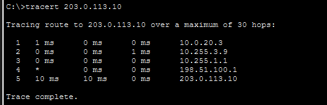
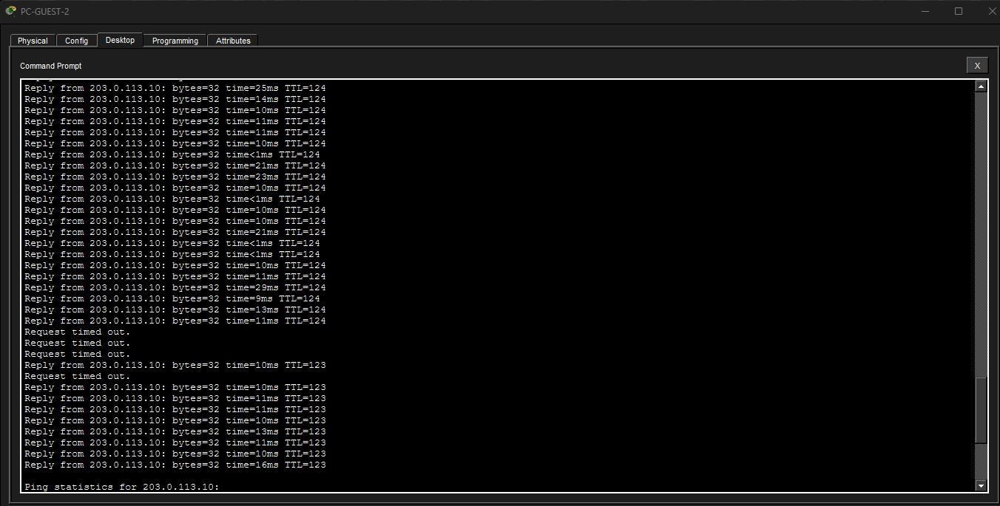
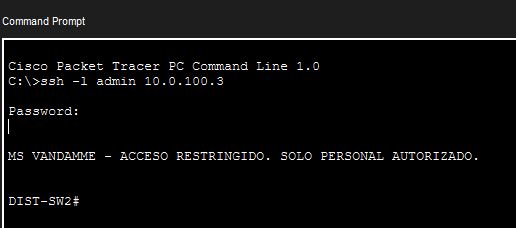
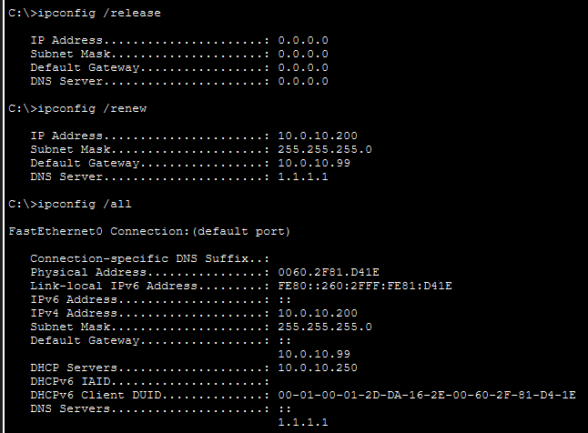
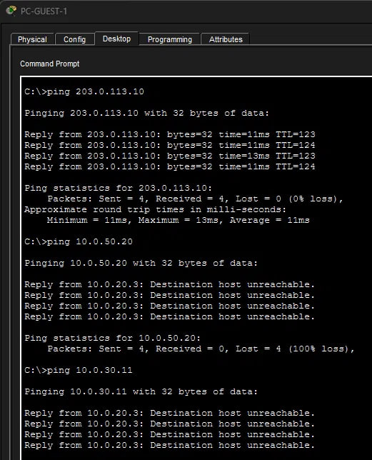
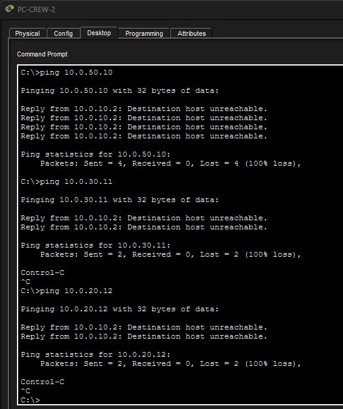
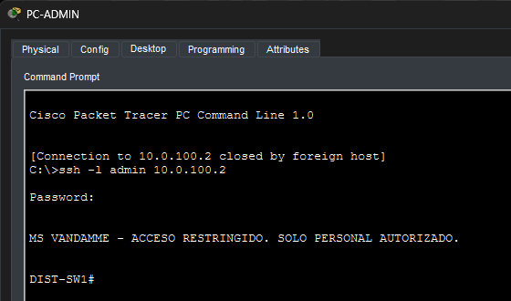
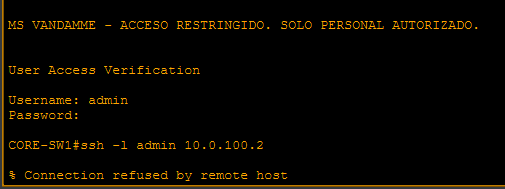
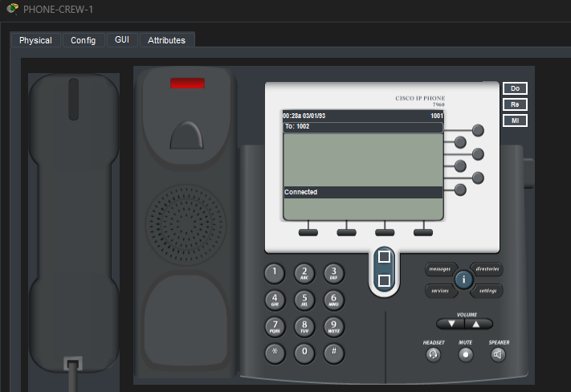

# MS Vandamme: red jerárquica de un buque crucero (Packet Tracer)

Diseño e implementación de la red de un crucero ficticio **MS Vandamme**, con arquitectura de tres capas (Access, Distribution, Core), gateways redundantes, enrutamiento OSPF multiárea y salida a Internet por dos enlaces satelitales.

> **Estado:** en desarrollo. Las Fases 0, 1, 2 y 3 están terminadas y verificadas; las Fases 4 y 5 (QoS, Wi-Fi, automatización) son opcionales. Ver [Estado del proyecto](#estado-del-proyecto).

Este proyecto es la segunda versión (v2) de un laboratorio anterior de campus básico con dos routers y un solo switch, que se conserva en [`v1-campus-basico/`](./v1-campus-basico). Las limitaciones de esa primera versión motivaron este rediseño (ver [De v1 a v2](#de-v1-a-v2)).

---

## Escenario

La red debe dar servicio a tres grupos con necesidades distintas: la **tripulación** (CREW), los **pasajeros** (GUESTS) y los sistemas del **puente de mando** (BRIDGE-OPS), además de un área de TI, voz IP y servidores. El enlace a Internet es satelital, por lo que se simulan **dos proveedores** (SAT-A y SAT-B) con redundancia entre ambos.

## Topología


| Capa | Equipos | Función |
|---|---|---|
| Internet simulado | SAT-A, SAT-B, SW-ISP, SRV-INTERNET | Proveedores satelitales y un servidor "en Internet" |
| WAN Edge | EDGE-R1, EDGE-R2 | Salida a Internet (NAT/PAT) y ruta por defecto |
| Core | CORE-SW1, CORE-SW2 | Backbone de capa 3 |
| Distribution | DIST-SW1, DIST-SW2 | Gateways de las VLANs (SVI + HSRP) |
| Access | ACC-CREW, ACC-GUEST, ACC-BRIDGE | Puertos de usuarios y teléfonos IP |
| Data Center | SW-DC, SRV-INFRA, SRV-WEB, R-VOZ | Servidores y telefonía (CME) |

Los enlaces Core–Distribution usan fibra monomodo (SFP GLC-LH-SMD); el resto usa cobre.

## Tecnologías

**Implementado:** VLANs y trunking 802.1Q · Rapid-PVST+ · EtherChannel LACP (capa 2 y capa 3) · HSRPv2 · OSPFv2 multiárea · NAT/PAT · port-security · BPDU Guard · DHCP central con relay · DHCP snooping · SSH · ACLs extendidas en las SVIs · SSH restringido a la VLAN de administración. · SSH restringido · telefonía IP con Cisco CME

**Herramienta:** Cisco Packet Tracer 9.0.1 (las Fases 1 y 2 se construyeron en 9.0.0.0810; ver problema 11). El archivo `.pkt` puede no abrirse en versiones anteriores.

---

## Estado del proyecto

| Fase | Contenido | Estado |
|---|---|---|
| 0 | Diseño, plan de direccionamiento y topología | ✅ Terminada |
| 1 | Capa 2 y gateways: VLANs, STP, EtherChannel, SVIs y HSRP | ✅ Terminada y verificada |
| 2 | Capa 3: OSPF multiárea, Edge, NAT/PAT, salida a Internet | ✅ Terminada y verificada |
| 3 | Servicios: DHCP central, ACLs entre VLANs, SSH, voz IP | ✅ Terminada |
| 4 | QoS, Wi-Fi, automatización (opcional) | ⏳ Pendiente |
| 5 | Pruebas de failover y documentación final | ⏳ Pendiente |

---

## Plan de direccionamiento

### VLANs y gateways (HSRP)

En cada VLAN: IP virtual (VIP) `.1`, DIST-SW1 `.2` y DIST-SW2 `.3`. El número de grupo HSRP coincide con el número de VLAN.

| VLAN | Nombre | Subred | HSRP activo |
|---|---|---|---|
| 10 | CREW | 10.0.10.0/24 | DIST-SW1 |
| 20 | GUESTS | 10.0.20.0/24 | DIST-SW2 |
| 30 | ADMIN-IT | 10.0.30.0/24 | DIST-SW1 |
| 40 | VOICE | 10.0.40.0/24 | DIST-SW2 |
| 50 | SERVERS | 10.0.50.0/24 | DIST-SW1 |
| 60 | BRIDGE-OPS | 10.0.60.0/24 | DIST-SW2 |
| 100 | MGMT | 10.0.100.0/24 | DIST-SW1 |
| 99 | NATIVE | sin IP | — |
| 999 | UNUSED | sin IP | — |

**Gestión (VLAN 100):** gateway virtual 10.0.100.1, DIST-SW1 .2, DIST-SW2 .3, ACC-CREW .11, ACC-GUEST .12, ACC-BRIDGE .13, SW-DC .20.

**DHCP central (SRV-INFRA, 10.0.50.10):** un pool por VLAN de usuarios, con rango desde `.11` (las direcciones `.1` a `.10` quedan reservadas para el VIP, los DIST y equipos fijos).

| VLAN | Pool | Gateway | Rango |
|---|---|---|---|
| 10 | VLAN10_CREW | 10.0.10.1 | .11 a .110 |
| 20 | VLAN20_GUESTS | 10.0.20.1 | .11 a .110 |
| 30 | VLAN30_ADMIN | 10.0.30.1 | .11 a .110 |
| 40 | VLAN40_VOICE | 10.0.40.1 | .11 a .110 (TFTP: 10.0.50.5) |
| 60 | VLAN60_BRIDGE | 10.0.60.1 | .11 a .110 |

### Enlaces punto a punto (/30)

| Enlace | Red |
|---|---|
| EDGE-R1 ↔ CORE-SW1 | 10.255.1.0/30 |
| EDGE-R1 ↔ CORE-SW2 | 10.255.1.4/30 |
| EDGE-R2 ↔ CORE-SW1 | 10.255.1.8/30 |
| EDGE-R2 ↔ CORE-SW2 | 10.255.1.12/30 |
| CORE-SW1 ↔ CORE-SW2 (Port-channel 10) | 10.255.2.0/30 |
| CORE-SW1 ↔ DIST-SW1 | 10.255.3.0/30 |
| CORE-SW1 ↔ DIST-SW2 | 10.255.3.4/30 |
| CORE-SW2 ↔ DIST-SW1 | 10.255.3.8/30 |
| CORE-SW2 ↔ DIST-SW2 | 10.255.3.12/30 |

### Loopbacks (router-id de OSPF)

| Equipo | Loopback0 | Área OSPF |
|---|---|---|
| EDGE-R1 / EDGE-R2 | 10.254.0.1 / 10.254.0.2 | 0 |
| CORE-SW1 / CORE-SW2 | 10.254.0.11 / 10.254.0.12 | 0 |
| DIST-SW1 / DIST-SW2 | 10.254.0.21 / 10.254.0.22 | 1 |

### Lado Internet (fuera de OSPF)

Se usan rangos de documentación (RFC 5737).

| Elemento | Dirección |
|---|---|
| SAT-A ↔ EDGE-R1 | 198.51.100.0/30 |
| SAT-B ↔ EDGE-R2 | 198.51.100.4/30 |
| Red de SW-ISP (SAT-A, SAT-B, SRV-INTERNET) | 203.0.113.0/24 |

---

## Decisiones de diseño

- **Gateways en la capa de distribución (SVI + HSRP), no en routers.** Los routers quedan solo en el borde. Esto evita el router-on-a-stick del v1 y permite enrutar entre VLANs a velocidad de switch.
- **Reparto de carga por VLAN.** HSRP no balancea dentro de un mismo grupo, así que DIST-SW1 es activo en las VLANs 10, 30, 50 y 100, y DIST-SW2 en las 20, 40 y 60.
- **Root de STP alineado con el HSRP activo** en cada VLAN, para que el tráfico no tome un camino más largo del necesario.
- **VTP en modo transparente.** Las VLANs se crean en cada switch en lugar de propagarse, para evitar que un switch con un número de revisión alto sobrescriba la base de VLANs de toda la red.
- **Puertos sin uso apagados.** En los switches de acceso, el Data Center y los DIST, los puertos libres van en `shutdown` dentro de la VLAN 999 (UNUSED), que no se permite en ningún trunk; la VLAN 99 se reserva como nativa. En los CORE y en los puertos de fibra libres solo se aplica `shutdown`, porque ahí no se conectan equipos de usuario.
- **EtherChannel de capa 2 entre los DIST** (trunk para las VLANs y los Hellos de HSRP) y **de capa 3 entre los CORE** (enlace enrutado /30).
- **OSPF multiárea:** área 0 para Core y Edge, área 1 para Distribution. Los CORE son los únicos ABR.
- **`passive-interface` en todas las SVIs** de los DIST, para que no se formen vecindades OSPF a través de las VLANs (ni entre los dos DIST ni con equipos conectados por error).
- **Router-id fijado manualmente** con la loopback de cada equipo, para que sea predecible y quede documentado.
- **Seguridad en los puertos de acceso:** PortFast, BPDU Guard y port-security con MAC sticky y `violation restrict` (máximo 3 MAC en los puertos con teléfono y PC).
- **Ruta por defecto estática flotante en los CORE como respaldo.** Cada CORE tiene `ip route 0.0.0.0 0.0.0.0 <IP de EDGE-R2> 200` (CORE-SW1 → 10.255.1.9, CORE-SW2 → 10.255.1.13). Con distancia administrativa 200 solo entra cuando OSPF (110) no instala la ruta por defecto, y se verificó en la prueba de failover (ver problema 7).
- **Acceso de gestión seguro.** SSH versión 2 con usuarios locales (`admin`, nivel 15, y `operador`, nivel 1), dominio `ship.local`, contraseñas cifradas, banner de advertencia y bloqueo tras intentos fallidos. Se aplicó a los 11 equipos del barco; SAT-A, SAT-B y SW-ISP simulan el Internet del proveedor y no llevan configuración de acceso.
- **Credenciales de laboratorio.** Enable y los usuarios usan la misma contraseña (`lab123`) en todos los equipos, solo para este ejercicio. En un entorno real cada equipo tendría credenciales distintas gestionadas de forma centralizada (AAA/RADIUS). Durante el desarrollo, el tiempo de inactividad de consola y vty está desactivado (`exec-timeout 0`) por comodidad.
- **DHCP centralizado con relay.** SRV-INFRA entrega las direcciones de todas las VLANs de usuarios mediante `ip helper-address` en las SVIs de **ambos DIST**, de modo que si uno cae, el otro sigue reenviando. Resuelve el problema de pools duplicados de la v1.
- **DHCP snooping en los switches de acceso**, solo en las VLANs con clientes (ACC-CREW: 10 y 40, ACC-GUEST: 20 y 40, ACC-BRIDGE: 60 y 40). Los uplinks a los DIST son puertos confiables y la opción 82 está desactivada.
- **ACLs de entrada en las SVIs, idénticas en ambos DIST.** Cada VLAN de usuarios tiene su ACL nombrada (`ACL-GUESTS-IN`, `ACL-CREW-IN`, `ACL-VOICE-IN`, `ACL-BRIDGE-IN`) aplicada en la SVI de los dos DIST, para que el filtrado sea el mismo si uno cae. GUESTS solo llega a DNS e Internet; CREW, a DNS, SRV-WEB e Internet; BRIDGE-OPS, a DNS y SRV-WEB, sin Internet; VOICE, solo a R-VOZ (TCP 2000) y TFTP. ADMIN-IT (VLAN 30) y las VLANs 50 y 100 no llevan ACL.
- **Las ACLs son sin estado, así que se permiten explícitamente** DHCP, HSRP (UDP 1985 a 224.0.0.2 y 224.0.0.102), ping al VIP y a los DIST, y las respuestas hacia ADMIN-IT (`echo-reply` y `tcp established`) para que TI pueda hacer ping y SSH hacia las demás VLANs. En GUESTS y CREW se bloquea `10.0.0.0/8` antes de permitir Internet.

---

## Verificación

### Fase 1: STP y HSRP alineados

La raíz de STP de cada VLAN coincide con el router HSRP activo.

```
DIST-SW1#show spanning-tree summary
Switch is in rapid-pvst mode
Root bridge for: CREW ADMIN-IT SERVERS MGMT

DIST-SW1#show standby brief
Interface   Grp  Pri P State    Active          Standby         Virtual IP
Vl10        10   110 P Active   local           10.0.10.3       10.0.10.1
Vl20        20   100   Standby  10.0.20.3       local           10.0.20.1
Vl30        30   110 P Active   local           10.0.30.3       10.0.30.1
Vl40        40   100   Standby  10.0.40.3       local           10.0.40.1
Vl50        50   110 P Active   local           10.0.50.3       10.0.50.1
Vl60        60   100   Standby  10.0.60.3       local           10.0.60.1
Vl100       100  110 P Active   local           10.0.100.3      10.0.100.1
```

```
DIST-SW2#show spanning-tree summary
Switch is in rapid-pvst mode
Root bridge for: GUESTS VOICE BRIDGE-OPS
```

Las VLANs NATIVE y UNUSED no tienen prioridad configurada y la raíz se decide por la MAC más baja; no afecta, porque no tienen SVI ni usuarios.

Evidencia completa en [`capturas/fase1/`](./capturas/fase1): [`vlans.txt`](./capturas/fase1/vlans.txt), [`stp-hsrp.txt`](./capturas/fase1/stp-hsrp.txt), [`trunks.txt`](./capturas/fase1/trunks.txt), [`etherchannel-l2.txt`](./capturas/fase1/etherchannel-l2.txt) y [`port-security.txt`](./capturas/fase1/port-security.txt).

### Fase 2: OSPF y salida a Internet

Evidencia en [`capturas/fase2/`](./capturas/fase2):

- [`ospf-neighbors.txt`](./capturas/fase2/ospf-neighbors.txt): vecinos OSPF en CORE-SW1, DIST-SW1 y EDGE-R1.
- [`ospf-areas.txt`](./capturas/fase2/ospf-areas.txt): área de cada interfaz.
- [`ospf-roles.txt`](./capturas/fase2/ospf-roles.txt): CORE-SW1 como ABR y EDGE-R1 y EDGE-R2 como ASBR.
- [`etherchannel-l3.txt`](./capturas/fase2/etherchannel-l3.txt): Port-channel 10 entre los CORE.
- [`rutas-dist.txt`](./capturas/fase2/rutas-dist.txt): rutas OSPF y ruta por defecto en DIST-SW1.
- [`nat.txt`](./capturas/fase2/nat.txt): traducciones NAT en ambos EDGE.

**Traza en operación normal** (`tracert` desde PC-GUEST-2): DIST-SW2 → CORE-SW2 → EDGE-R1 → SAT-A → servidor.



### Prueba de failover del enlace satelital principal

| Paso | Resultado |
|---|---|
| `ping 203.0.113.10 -t` desde PC de la VLAN 10 | Responde con TTL 124 (salida por EDGE-R1) |
| `shutdown` en EDGE-R1 Gi0/0/0 (hacia SAT-A) | Unos 10 paquetes con TTL 123 (ya por EDGE-R2) y luego pérdida total |
| Causa | CORE-SW1 no instalaba la ruta por defecto (ver problema 7) |
| Tras la ruta estática flotante en CORE-SW1 | Ping recuperado |
| `no shutdown` en EDGE-R1 | La ruta OSPF (`O*E2` vía 10.255.1.1) vuelve a CORE-SW1 y la estática flotante queda en reserva |

**Repetición tras agregar las rutas estáticas flotantes** (ping continuo desde PC-GUEST-2, VLAN 20): al apagar la salida de EDGE-R1 hacia SAT-A se pierden unos 4 paquetes y el tráfico pasa a EDGE-R2. El TTL de las respuestas baja de 124 a 123 porque el camino por SAT-B tiene un salto más.



**Acceso SSH** (banner de advertencia y sesión iniciada en DIST-SW2, sin restricciones por ahora): evidencia en [`ssh.txt`](./capturas/fase3/ssh.txt) y en la captura siguiente. Pendiente: restringir SSH a la VLAN 30 al terminar las ACLs.



### Fase 3: DHCP snooping

**Prueba del servidor DHCP falso** (un servidor no autorizado en un puerto de usuario de ACC-CREW, VLAN 10):

| Condición | Resultado |
|---|---|
| Snooping desactivado | La PC toma 10.0.10.200 con gateway 10.0.10.99, DNS 1.1.1.1 y servidor DHCP 10.0.10.250 (el falso) |
| Snooping activo | En tres renovaciones seguidas la PC toma 10.0.10.11 o .12 con gateway 10.0.10.1 y servidor DHCP 10.0.50.10 (SRV-INFRA) |




Configuración y puertos confiables en [`capturas/fase3/dhcp-snooping.txt`](./capturas/fase3/dhcp-snooping.txt).

### Fase 3: ACLs entre VLANs

Matriz de pruebas (✅ = pasa, ❌ = bloqueado). El esperado coincidió con el real en todos los casos.

| Origen | Destino | Esperado | Real |
|---|---|---|---|
| PC-GUEST | Gateway 10.0.20.1 | ✅ | ✅ |
| PC-GUEST | Internet (203.0.113.10) | ✅ | ✅ |
| PC-GUEST | SRV-WEB (10.0.50.20) | ❌ | ❌ |
| PC-GUEST | PC-ADMIN | ❌ | ❌ |
| PC-CREW | DHCP (release/renew) y gateway | ✅ | ✅ |
| PC-CREW | Internet | ✅ | ✅ |
| PC-CREW | SRV-WEB (ping y HTTP) | ✅ | ✅ |
| PC-CREW | SRV-INFRA (10.0.50.10) | ❌ | ❌ |
| PC-CREW | PC-ADMIN y PC-GUEST | ❌ | ❌ |
| PC-BRIDGE | SRV-WEB (ping y HTTP) | ✅ | ✅ |
| PC-BRIDGE | Internet y SRV-INFRA | ❌ | ❌ |
| PC-BRIDGE | PC-ADMIN | ❌ | ❌ |
| PC-ADMIN | PC-GUEST, PC-CREW, PC-BRIDGE y teléfonos VLAN 40 | ✅ | ✅ |

**Failover con las ACLs:** con DIST-SW1 apagado, DIST-SW2 quedó Active en las 7 VLANs y siguió filtrando igual (PC-CREW llegó a SRV-WEB e Internet y siguió sin llegar a SRV-INFRA). Al encenderlo, el reparto original volvió por preempt y las cuatro líneas `ip access-group` seguían en DIST-SW1.

**HSRPv2:** en los contadores de las ACLs, los hello de HSRP aparecen en la línea de `224.0.0.102` (HSRPv2) y la de `224.0.0.2` (HSRPv1) queda sin coincidencias, lo que concuerda con `standby version 2`.

**Notas:**
- Los pings a 203.0.113.10 a veces pierden el primer paquete, también sin failover. Causa no determinada.
- Al aplicar `ACL-BRIDGE-IN` hubo cambios breves de estado HSRP (VLAN 30 y VLAN 60) que se resolvieron solos, con un solo Active por VLAN al final. La VLAN 30 no tiene ACL. Causa no determinada.
- ACL-VOICE-IN: probada con el registro y las llamadas de los teléfonos (ver Fase 3: voz IP).




Evidencia en [`capturas/fase3/acls.txt`](./capturas/fase3/acls.txt) y [`capturas/fase3/failover-dist.txt`](./capturas/fase3/failover-dist.txt).

### Fase 3: SSH restringido a ADMIN-IT

Los 11 equipos con SSH aceptan conexiones solo desde la VLAN 30. Se usa la ACL estándar `SSH-ADMIN` aplicada con `access-class` en las líneas vty 0-4 y 5-15. El mismo bloque se aplicó en los 11 equipos y se probó en tres (DIST-SW1, CORE-SW1 y ACC-CREW).

| Origen | Destino | Esperado | Real |
|---|---|---|---|
| PC-ADMIN (VLAN 30) | DIST-SW1 (10.0.100.2) | ✅ | ✅ |
| PC-ADMIN | CORE-SW1 (loopback 10.254.0.11) | ✅ | ✅ |
| PC-ADMIN | ACC-CREW (10.0.100.11) | ✅ | ✅ |
| CORE-SW1 (fuera de la VLAN 30) | DIST-SW1 | ❌ | ❌ (Connection refused) |

Consecuencia: ya no se puede saltar por SSH de un equipo a otro; el acceso es solo desde la VLAN 30.




Evidencia en [`capturas/fase3/ssh-restringido.txt`](./capturas/fase3/ssh-restringido.txt).

### Fase 3: voz IP (Cisco CME)

R-VOZ (10.0.50.5) ofrece telefonía con `telephony-service` sobre SCCP (TCP 2000). Los 4 teléfonos, en la VLAN 40, reciben IP del DHCP central y se registran solos. Las extensiones se asignan por orden de registro y se ajustaron para que cada área tenga su rango: CREW 1001-1002, GUEST 1101, BRIDGE 2001.

| Prueba | Esperado | Real |
|---|---|---|
| Registro de los 4 teléfonos en R-VOZ | ✅ | ✅ |
| Llamada 1001 → 1002 | ✅ | ✅ |
| Extensiones tras cerrar y reabrir el .pkt | Sin cambios | Sin cambios |
| `ACL-VOICE-IN`: TCP 2000 hacia R-VOZ | Permitido | 82 coincidencias en DIST-SW2 |
| SSH desde PC-ADMIN a R-VOZ | ✅ | ✅ |

En una red real, la voz (RTP) viajaría de teléfono a teléfono dentro de la VLAN 40, y solo el registro y la señalización (TCP 2000) llegarían a R-VOZ por la VLAN 50. En Packet Tracer el audio no se puede comprobar: `show ephone` muestra las llamadas en CONNECTED con 0 paquetes de voz (Tx/Rx Pkts 0).



Evidencia en [`capturas/fase3/voz-ip.txt`](./capturas/fase3/voz-ip.txt).

---

## Problemas encontrados y cómo se resolvieron

### 1. Enlaces de fibra Core–Distribution en estado down
**Síntoma:** tras conectar los CORE y los DIST con fibra, los puertos quedaban en down aunque tenían `no shutdown`.
**Causa:** el módulo SFP era un **GLC-LH-SMD** (1000BASE-LX/LH, monomodo) y el cable era multimodo. El tipo de fibra del cable debe coincidir con el del transceiver.
**Solución:** cambiar el cable a monomodo y verificar que los cuatro enlaces estuvieran en up/up.

### 2. Puertos sin uso en la VLAN nativa
**Síntoma (detectado en la revisión del diseño):** el plan inicial dejaba los puertos apagados en la VLAN 99, que también es la nativa de los trunks.
**Solución:** crear la VLAN 999 (UNUSED), asignar a ella los puertos sin uso en `shutdown` y no incluirla en ningún trunk.

### 3. Línea `network 0.0.0.0 255.255.255.255 area 1` que apareció sola
**Síntoma:** en el proceso OSPF apareció una línea ancha que no se había escrito de forma intencional.
**Causa probable:** el comando `network` espera una **wildcard**, no una máscara. Al escribir `255.255.255.255` como wildcard, se activó OSPF en todas las interfaces con IP del switch.
**Solución:** usar la IP exacta de cada interfaz con wildcard `0.0.0.0` (por ejemplo `network 10.255.3.9 0.0.0.0 area 1`) y eliminar la línea ancha.

### 4. CORE-SW2 sin adyacencia con los DIST
**Síntoma:** CORE-SW2 formaba vecindad con los EDGE y con CORE-SW1, pero no con los DIST, aunque su configuración era igual a la de CORE-SW1. `show ip ospf interface` en los puertos de fibra respondía "OSPF not enabled".
**Contexto:** poco antes se había pegado por error un bloque de comandos en la consola, y la mayoría falló.
**Solución:** borrar y volver a escribir los dos comandos `network` de los enlaces de fibra, lo que hizo que Packet Tracer volviera a evaluar las interfaces. La causa exacta del estado inconsistente no se pudo determinar.
**Lección:** pegar primero los comandos en un bloc de notas, para no ejecutar por accidente lo que haya quedado en el portapapeles.

### 5. Diferencias entre Packet Tracer y un IOS real
- `ip ospf network point-to-point` **no está disponible** en interfaces Port-channel. El enlace Core–Core opera como broadcast con elección de DR/BDR; la adyacencia llega a FULL igualmente.
- `ip ospf <pid> area <x>` **no se acepta** en los puertos SFP de fibra. En esos enlaces se usó el comando `network` con IP exacta; en el resto de interfaces se usa el método por interfaz.
- `default-information originate` **no admite `metric` ni `metric-type`** en los ISR 4331 y 2911 de Packet Tracer. La preferencia por EDGE-R1 se simuló con `ip ospf cost` en los enlaces hacia EDGE-R2 (ver problema 7).
- `login block-for` **no está disponible en los switches de capa 2** (ACC y SW-DC) de Packet Tracer; el bloqueo tras intentos fallidos solo se configuró en los equipos de capa 3.

### 6. Redes de usuarios no alcanzables desde el Edge (SVIs fuera de OSPF)
**Síntoma:** un PC de la VLAN 20 con IP fija llegaba a su gateway (10.0.20.3, DIST-SW2) pero no a Internet. El `tracert` hacia el servidor se cortaba en el segundo salto. Desde EDGE-R1, el ping a SAT-A sí funcionaba.
**Diagnóstico:** en EDGE-R1, `show ip route` mostraba rutas `O IA` hacia las loopbacks y los enlaces /30 de los DIST, pero **ninguna hacia las redes 10.0.x.0/24 de las VLANs**. Los paquetes de ida llegaban a Internet, pero las respuestas no tenían ruta de vuelta.
**Causa:** las SVIs de los DIST no estaban activadas en OSPF. `passive-interface` solo evita el envío de Hellos por la interfaz; no hace que su red se anuncie, para eso hay que activar OSPF en la interfaz.
**Solución:** agregar `ip ospf 1 area 1` en cada SVI de DIST-SW1 y DIST-SW2, manteniendo los `passive-interface`. Después, EDGE-R1 aprendió las siete redes de VLANs como `O IA` y el `tracert` hacia 203.0.113.1 completó los cuatro saltos.
**Lección:** tras activar OSPF, comprobar con `show ip route` en el Edge que aparezca una ruta `O IA` por cada VLAN, y probar con `tracert` desde un PC, porque un ping al gateway no demuestra que el tráfico pueda volver.

### 7. Failover de la ruta por defecto: CORE-SW1 no instala la ruta de respaldo
**Síntoma:** al apagar la interfaz de EDGE-R1 hacia SAT-A, el ping desde un PC de la VLAN 10 respondió durante unos segundos y luego solo devolvió "Destination host unreachable" (desde 10.255.3.1 y 10.255.3.5, las interfaces de CORE-SW1 hacia los DIST) y timeouts, sin recuperarse.
**Diagnóstico:**
- EDGE-R1 dejó de anunciar la ruta por defecto, como se esperaba (`default-information originate` sin `always`).
- En CORE-SW1, la LSA externa de EDGE-R2 estaba en la base de datos OSPF (`show ip ospf database external`), junto con una copia antigua con edad 3600 s, pero `show ip route 0.0.0.0` respondía "Network not in table".
- DIST-SW1 y DIST-SW2 tenían a CORE-SW1 como siguiente salto, así que el tráfico llegaba a un switch sin ruta y se descartaba.
- CORE-SW2 sí instaló la ruta vía EDGE-R2. En operación normal, CORE-SW2 instalaba dos rutas (ECMP) pese al costo 100 y CORE-SW1 solo una.
- La configuración es simétrica: costos 1 y 100 correctos (`show ip ospf interface brief`, `show ip ospf border-routers`), adyacencias en FULL, sin cambios tras `clear ip ospf process` ni `reload`.
**Causa:** no determinada con certeza; consistente con un manejo inconsistente de rutas externas E2 por parte de Packet Tracer en los switches de capa 3.
**Solución:** ruta estática flotante en CORE-SW1 hacia EDGE-R2: `ip route 0.0.0.0 0.0.0.0 10.255.1.9 200`. Con distancia administrativa 200 solo entra cuando OSPF (110) no tiene ruta por defecto. Tras aplicarla, el ping se recuperó. También se agregó ruta estática en CORE-SW2 por simetría.
**Lección:** el failover hay que probarlo desde más de una VLAN y revisando la tabla de rutas de cada equipo del camino. Un ping exitoso desde la VLAN 20 no habría revelado el problema, porque su tráfico no pasaba por CORE-SW1.
  
### 8. Servidores sin conectividad: puertos de SW-DC sin configurar
**Síntoma:** tras configurar el relay DHCP, los PCs no recibían IP y no había ping al servidor SRV-INFRA.
**Causa:** los puertos de SW-DC hacia los servidores y R-VOZ no tenían configuración de acceso (VLAN 50).
**Solución:** `switchport mode access` y VLAN 50 en Fa0/1 a Fa0/3, más PortFast, BPDU Guard y port-security. Tras eso, el DHCP funcionó.
**Lección:** comprobar primero la conectividad al servidor antes de depurar el DHCP.

### 9. Port-security con máximo 2 genera violaciones en puertos con teléfono y PC
**Síntoma:** al pedir IP desde las PCs conectadas detrás de un teléfono, ACC-CREW mostró `PSECURE_VIOLATION` en Fa0/1 y Fa0/2, aunque ambos puertos tenían `maximum 2` y las PCs recibían IP.
**Diagnóstico:** `show port-security interface` indicaba 2 MAC aprendidas y un contador de violaciones creciente. La MAC que provocaba el aviso no coincidía con la de la PC ni con la guardada del teléfono. Con `violation restrict` el puerto seguía funcionando.
**Causa:** no determinada con certeza; es consistente con un comportamiento de Packet Tracer al contar MAC en puertos con VLAN de voz.
**Solución:** subir el máximo a 3, borrar las MAC aprendidas y reiniciar el puerto. Los avisos desaparecieron.

### 10. El servidor DHCP falso no entregaba su pool
**Síntoma:** con el snooping desactivado, la PC no tomaba IP del servidor falso aunque su pool estaba configurado.
**Causa probable:** el servidor traía un pool por defecto (`serverPool`) en la misma red 10.0.10.0/24, que interfería con el pool de prueba y no se puede eliminar.
**Solución:** cambiar el rango de `serverPool` a otra red. Después, la PC tomó la IP del servidor falso.

### 11. `ip access-group` en las SVIs no aparecía en la configuración (PT 9.0.0.0810)
**Síntoma:** en 9.0.0.0810, la línea `ip access-group` no aparecía en `show run` ni en `show ip interface` ("Inbound access list is not set") y no persistía al reabrir el .pkt, aunque la ACL filtraba con el archivo abierto.
**Diagnóstico:** los pings a destinos bloqueados devolvían "Destination host unreachable" desde el DIST activo y los contadores de `show access-lists` subían solo ahí. Al reabrir el .pkt, las ACLs seguían definidas pero dejaban de estar aplicadas.
**Solución:** instalar Packet Tracer 9.0.1 y reaplicar las ACLs en las SVIs. Desde entonces la línea aparece en `show run` y persiste tras cerrar y reabrir.
**Causa:** no determinada (comportamiento de 9.0.0.0810).

### 12. Los usuarios de los switches L2 no conservan el privilegio 15 (PT 9.0.1)
**Síntoma:** en los switches L2, `username admin privilege 15 secret ...` se acepta, pero `show run | include admin` muestra el usuario sin `privilege 15`. Al cerrar y reabrir el .pkt, el SSH entra en modo usuario (`ACC-CREW>`), mientras que en los equipos L3 entra directo en `#`.
**Verificación:** reproducido en los cuatro L2 (ACC-CREW, ACC-GUEST, ACC-BRIDGE y SW-DC) con Packet Tracer 9.0.1. Mientras el archivo está abierto el privilegio funciona; al reabrir se pierde.
**Solución:** tras entrar por SSH a un L2, usar `enable` con el enable secret.
**Causa:** no determinada (comportamiento de Packet Tracer).

## De v1 a v2

La versión 1 (campus básico) funcionaba, pero al revisarla con más criterio aparecieron limitaciones que dieron origen a este rediseño:

- **DHCP en los dos routers con los mismos pools**, lo que puede entregar la misma dirección a equipos distintos.
- **Un servidor con IP fija dentro del rango del DHCP** de su VLAN.
- **HSRP sin tracking** de la interfaz de salida: si el router activo pierde Internet, sigue siendo activo.
- **ACLs asimétricas** entre VLANs: el aislamiento funcionaba parcialmente "por accidente".
- **Un único switch**, sin redundancia de capa 2, y un router por cada función de gateway.

En la v2, el DHCP pasó a un servidor central, las ACLs se aplican en las SVIs de ambos DIST con las mismas reglas, y los puntos únicos de falla se eliminan con la jerarquía de tres capas.

---

## Limitaciones y mejoras futuras

- Packet Tracer no simula la **latencia ni el ancho de banda variable** de un enlace satelital real.
- No se simulan los transceivers ni las distancias de fibra más allá del tipo de módulo.
- **Mejoras previstas:** QoS en el Edge, Wi-Fi con controladora, automatización de respaldos con Python/Netmiko, replicar el bloque de distribución por cubiertas.
- Las ACLs son **sin estado**: `tcp established` solo mira las banderas del paquete y no sustituye a un firewall.
- El router 2911 de Packet Tracer no ofrece `telephony-service` (ni activando la licencia de voz). R-VOZ usa un 2811, que sí lo trae, con puertos FastEthernet.

---

## Estructura del repositorio

```
├── README.md
├── docs/
│   ├── topologia.png
│   └── cableado.md
├── v1-campus-basico/
├── configs/          (running-config de cada equipo, sin secretos)
├── capturas/         (salidas de verificación por fase)
└── crucero-v2.pkt
```

> Los archivos de `configs/` tienen los hashes de contraseñas reemplazados por `<REDACTED>`.

## Autor

**Robert Duran** — Ingeniero electrónico, CCNA 200-301
[LinkedIn](https://www.linkedin.com/in/robert-duran-electronic) · [Credly](https://www.credly.com/badges/bd075323-7943-4c86-960e-0b7b7d7216fe/public_url)
