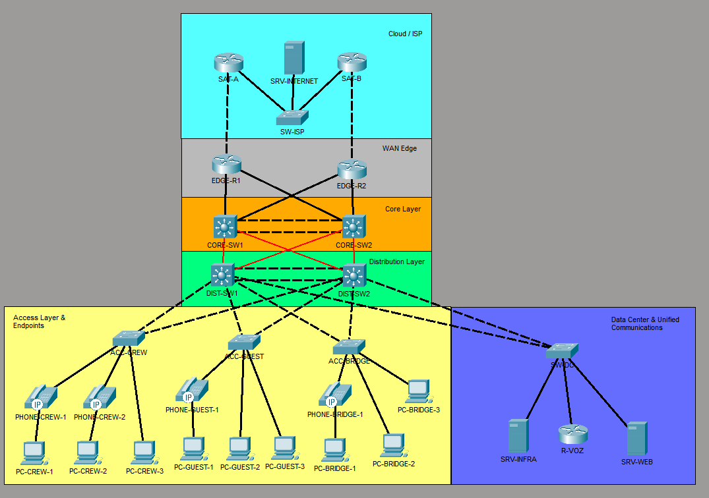

# Red jerárquica de un buque crucero (Packet Tracer)

Diseño e implementación de la red de un crucero ficticio, Van Damme, con arquitectura de tres capas (Access, Distribution, Core), gateways redundantes, enrutamiento OSPF multiárea y salida a Internet por dos enlaces satelitales.

> **Estado:** en desarrollo. Las Fases 0 y 1 están terminadas y verificadas; la Fase 2 está en curso. Ver [Estado del proyecto](#estado-del-proyecto).

Este proyecto es la segunda versión (v2) de un laboratorio anterior de campus básico con dos routers y un solo switch, que se conserva en [`v1-campus-basico/`](./v1-campus-basico). Las limitaciones de esa primera versión motivaron este rediseño (ver [De v1 a v2](#de-v1-a-v2)).

---

## Escenario

La red debe dar servicio a tres grupos con necesidades distintas: la **tripulación** (CREW), los **pasajeros** (GUESTS) y los sistemas del **puente de mando** (BRIDGE-OPS), además de un área de TI, voz IP y servidores. El enlace a Internet es satelital, por lo que se simulan **dos proveedores** (SAT-A y SAT-B) con un enlace principal y uno de respaldo.

## Topología



| Capa | Equipos | Función |
|---|---|---|
| Internet simulado | SAT-A, SAT-B, SW-ISP, SRV-INTERNET | Proveedores satelitales y un servidor "en Internet" |
| WAN Edge | EDGE-R1, EDGE-R2 | Salida a Internet (NAT/PAT) y ruta por defecto |
| Core | CORE-SW1, CORE-SW2 | Backbone de capa 3 |
| Distribution | DIST-SW1, DIST-SW2 | Gateways de las VLANs (SVI + HSRP) |
| Access | ACC-CREW, ACC-GUEST, ACC-BRIDGE | Puertos de usuarios y teléfonos IP |
| Data Center | SW-DC, SRV-INFRA, SRV-WEB, R-VOZ | Servidores y telefonía (CME) |

Los enlaces Core–Distribution usan fibra monomodo (SFP GLC-LH-SMD); el resto usa cobre.

## Tecnologías

VLANs y trunking 802.1Q · Rapid-PVST+ · EtherChannel LACP (capa 2 y capa 3) · HSRP v2 · OSPFv2 multiárea · NAT/PAT · ACLs · SSH · port-security · BPDU Guard · DHCP · telefonía IP con Cisco CME

---

## Estado del proyecto

| Fase | Contenido | Estado |
|---|---|---|
| 0 | Diseño, plan de direccionamiento y topología | ✅ Terminada |
| 1 | Capa 2 y gateways: VLANs, STP, EtherChannel, SVIs y HSRP | ✅ Terminada y verificada |
| 2 | Capa 3: OSPF multiárea, Edge, NAT/PAT, salida a Internet | 🔄 OSPF funcionando; Edge/NAT en curso |
| 3 | Servicios: DHCP central, ACLs entre VLANs, SSH, voz IP | ⏳ Pendiente |
| 4 | QoS, Wi-Fi, automatización (opcional) | ⏳ Pendiente |
| 5 | Pruebas de failover y documentación final | ⏳ Pendiente |

---

## Plan de direccionamiento

### VLANs y gateways (HSRP)

En cada VLAN: IP virtual (VIP) `.1`, DIST-SW1 `.2` y DIST-SW2 `.3`. El número de grupo HSRP coincide con el número de VLAN.

| VLAN | Nombre | Subred | HSRP activo |
|---|---|---|---|
| 10 | CREW | 10.0.10.0/24 | DIST-SW1 |
| 20 | GUESTS | 10.0.20.0/24 | DIST-SW2 |
| 30 | ADMIN-IT | 10.0.30.0/24 | DIST-SW1 |
| 40 | VOICE | 10.0.40.0/24 | DIST-SW2 |
| 50 | SERVERS | 10.0.50.0/24 | DIST-SW1 |
| 60 | BRIDGE-OPS | 10.0.60.0/24 | DIST-SW2 |
| 100 | MGMT | 10.0.100.0/24 | DIST-SW1 |
| 99 | NATIVE | sin IP | — |
| 999 | UNUSED | sin IP | — |

### Enlaces punto a punto (/30)

| Enlace | Red |
|---|---|
| EDGE-R1 ↔ CORE-SW1 | 10.255.1.0/30 |
| EDGE-R1 ↔ CORE-SW2 | 10.255.1.4/30 |
| EDGE-R2 ↔ CORE-SW1 | 10.255.1.8/30 |
| EDGE-R2 ↔ CORE-SW2 | 10.255.1.12/30 |
| CORE-SW1 ↔ CORE-SW2 (Port-channel 10) | 10.255.2.0/30 |
| CORE-SW1 ↔ DIST-SW1 | 10.255.3.0/30 |
| CORE-SW1 ↔ DIST-SW2 | 10.255.3.4/30 |
| CORE-SW2 ↔ DIST-SW1 | 10.255.3.8/30 |
| CORE-SW2 ↔ DIST-SW2 | 10.255.3.12/30 |

### Loopbacks (router-id de OSPF)

| Equipo | Loopback0 | Área OSPF |
|---|---|---|
| EDGE-R1 / EDGE-R2 | 10.254.0.1 / 10.254.0.2 | 0 |
| CORE-SW1 / CORE-SW2 | 10.254.0.11 / 10.254.0.12 | 0 |
| DIST-SW1 / DIST-SW2 | 10.254.0.21 / 10.254.0.22 | 1 |

### Lado Internet (fuera de OSPF)

Se usan rangos de documentación (RFC 5737).

| Elemento | Dirección |
|---|---|
| SAT-A ↔ EDGE-R1 | 198.51.100.0/30 |
| SAT-B ↔ EDGE-R2 | 198.51.100.4/30 |
| Red de SW-ISP (SAT-A, SAT-B, SRV-INTERNET) | 203.0.113.0/24 |

---

## Decisiones de diseño

- **Gateways en la capa de distribución (SVI + HSRP), no en routers.** Los routers quedan solo en el borde. Esto evita el router-on-a-stick del v1 y permite enrutar entre VLANs a velocidad de switch.
- **Reparto de carga por VLAN.** HSRP no balancea dentro de un mismo grupo, así que DIST-SW1 es activo en las VLANs 10, 30, 50 y 100, y DIST-SW2 en las 20, 40 y 60.
- **Root de STP alineado con el HSRP activo** en cada VLAN, para que el tráfico no tome un camino más largo del necesario.
- **VTP en modo transparente.** Las VLANs se crean en cada switch en lugar de propagarse, para evitar que un switch con un número de revisión alto sobrescriba la base de VLANs de toda la red.
- **Puertos sin uso en una VLAN dedicada (999, UNUSED)**, apagados y fuera de todos los trunks. La VLAN 99 se reserva como nativa de los trunks, sin puertos de acceso.
- **EtherChannel de capa 2 entre los DIST** (trunk para las VLANs y los Hellos de HSRP) y **de capa 3 entre los CORE** (enlace enrutado /30).
- **OSPF multiárea:** área 0 para Core y Edge, área 1 para Distribution. Los CORE son los únicos ABR.
- **`passive-interface` en todas las SVIs** de los DIST, para que no se formen vecindades OSPF a través de las VLANs (ni entre los dos DIST ni con equipos conectados por error).
- **Router-id fijado manualmente** con la loopback de cada equipo, para que sea predecible y quede documentado.
- **Seguridad en los puertos de acceso:** PortFast, BPDU Guard y port-security con MAC sticky y `violation restrict` (máximo 2 MAC en los puertos con teléfono y PC).

---

## Verificación

### Fase 1: STP y HSRP alineados

La raíz de STP de cada VLAN coincide con el router HSRP activo.

```
DIST-SW1#show spanning-tree summary
Switch is in rapid-pvst mode
Root bridge for: CREW ADMIN-IT SERVERS MGMT

DIST-SW1#show standby brief
Interface   Grp  Pri P State    Active          Standby         Virtual IP
Vl10        10   110 P Active   local           10.0.10.3       10.0.10.1
Vl20        20   100   Standby  10.0.20.3       local           10.0.20.1
Vl30        30   110 P Active   local           10.0.30.3       10.0.30.1
Vl40        40   100   Standby  10.0.40.3       local           10.0.40.1
Vl50        50   110 P Active   local           10.0.50.3       10.0.50.1
Vl60        60   100   Standby  10.0.60.3       local           10.0.60.1
Vl100       100  110 P Active   local           10.0.100.3      10.0.100.1
```

```
DIST-SW2#show spanning-tree summary
Switch is in rapid-pvst mode
Root bridge for: GUESTS VOICE BRIDGE-OPS NATIVE UNUSED
```

Las VLANs NATIVE y UNUSED no tienen prioridad configurada y la raíz se decide por la MAC más baja; no afecta, porque no tienen SVI ni usuarios.

### Fase 2: OSPF

*(Pendiente: insertar capturas de `show ip ospf neighbor` en un CORE y un DIST, `show ip route` en un DIST y `show ip ospf` mostrando los roles ABR/ASBR.)*

### Pruebas de failover

### Prueba de failover del enlace satelital principal
| Paso | Resultado |
|---|---|
| `ping 203.0.113.10 -t` desde PC de la VLAN 10 | Responde con TTL 124 (salida por EDGE-R1) |
| `shutdown` en EDGE-R1 Gi0/0/0 (hacia SAT-A) | Unos 10 paquetes con TTL 123 (ya por EDGE-R2) y luego pérdida total |
| Causa | CORE-SW1 no instalaba la ruta por defecto (ver problema 7) |
| Tras la ruta estática flotante en CORE-SW1 | Ping recuperado |
| `no shutdown` en EDGE-R1 | *(completar: ruta OSPF vuelve a CORE-SW1, el ping sigue)* |

---

## Problemas encontrados y cómo se resolvieron

### 1. Enlaces de fibra Core–Distribution en estado down
**Síntoma:** tras conectar los CORE y los DIST con fibra, los puertos quedaban en down aunque tenían `no shutdown`.
**Causa:** el módulo SFP era un **GLC-LH-SMD** (1000BASE-LX/LH, monomodo) y el cable era multimodo. El tipo de fibra del cable debe coincidir con el del transceiver.
**Solución:** cambiar el cable a monomodo y verificar que los cuatro enlaces estuvieran en up/up.

### 2. Puertos sin uso en la VLAN nativa
**Síntoma (detectado en la revisión del diseño):** el plan inicial dejaba los puertos apagados en la VLAN 99, que también es la nativa de los trunks.
**Solución:** crear la VLAN 999 (UNUSED), asignar a ella los puertos sin uso en `shutdown` y no incluirla en ningún trunk.

### 3. Línea `network 0.0.0.0 255.255.255.255 area 1` que apareció sola
**Síntoma:** en el proceso OSPF apareció una línea ancha que no se había escrito de forma intencional.
**Causa probable:** el comando `network` espera una **wildcard**, no una máscara. Al escribir `255.255.255.255` como wildcard, se activó OSPF en todas las interfaces con IP del switch.
**Solución:** usar la IP exacta de cada interfaz con wildcard `0.0.0.0` (por ejemplo `network 10.255.3.9 0.0.0.0 area 1`) y eliminar la línea ancha.

### 4. CORE-SW2 sin adyacencia con los DIST
**Síntoma:** CORE-SW2 formaba vecindad con los EDGE y con CORE-SW1, pero no con los DIST, aunque su configuración era igual a la de CORE-SW1. `show ip ospf interface` en los puertos de fibra respondía "OSPF not enabled".
**Contexto:** poco antes se había pegado por error un bloque de comandos en la consola, y la mayoría falló.
**Solución:** borrar y volver a escribir los dos comandos `network` de los enlaces de fibra, lo que hizo que Packet Tracer volviera a evaluar las interfaces. La causa exacta del estado inconsistente no se pudo determinar.
**Lección:** pegar primero los comandos en un bloc de notas, para no ejecutar por accidente lo que haya quedado en el portapapeles.

### 5. Diferencias entre Packet Tracer y un IOS real
- `ip ospf network point-to-point` **no está disponible** en interfaces Port-channel. El enlace Core–Core opera como broadcast con elección de DR/BDR; la adyacencia llega a FULL igualmente.
- `ip ospf <pid> area <x>` **no se acepta** en los puertos SFP de fibra. En esos enlaces se usó el comando `network` con IP exacta; en el resto de interfaces se usa el método por interfaz.

---

### 6. Redes de usuarios no alcanzables desde el Edge (SVIs fuera de OSPF)
**Síntoma:** un PC de la VLAN 20 con IP fija llegaba a su gateway (10.0.20.3, DIST-SW2) pero no a Internet. El `tracert` hacia el servidor se cortaba en el segundo salto. Desde EDGE-R1, el ping a SAT-A sí funcionaba.
**Diagnóstico:** en EDGE-R1, `show ip route` mostraba rutas `O IA` hacia las loopbacks y los enlaces /30 de los DIST, pero **ninguna hacia las redes 10.0.x.0/24 de las VLANs**. Los paquetes de ida llegaban a Internet, pero las respuestas no tenían ruta de vuelta.
**Causa:** las SVIs de los DIST no estaban activadas en OSPF. `passive-interface` solo evita el envío de Hellos por la interfaz; no hace que su red se anuncie, para eso hay que activar OSPF en la interfaz.
**Solución:** agregar `ip ospf 1 area 1` en cada SVI de DIST-SW1 y DIST-SW2, manteniendo los `passive-interface`. Después, EDGE-R1 aprendió las siete redes de VLANs como `O IA` y el `tracert` hacia 203.0.113.1 completó los cuatro saltos.
**Lección:** tras activar OSPF, comprobar con `show ip route` en el Edge que aparezca una ruta `O IA` por cada VLAN, y probar con `tracert` desde un PC, porque un ping al gateway no demuestra que el tráfico pueda volver.

### 7. Failover de la ruta por defecto: CORE-SW1 no instala la ruta de respaldo
**Síntoma:** al apagar la interfaz de EDGE-R1 hacia SAT-A, el ping desde un PC de la VLAN 10 respondió durante unos segundos y luego solo devolvió "Destination host unreachable" (desde 10.255.3.1 y 10.255.3.5, las interfaces de CORE-SW1 hacia los DIST) y timeouts, sin recuperarse.
**Diagnóstico:**
- EDGE-R1 dejó de anunciar la ruta por defecto, como se esperaba (`default-information originate` sin `always`).
- En CORE-SW1, la LSA externa de EDGE-R2 estaba en la base de datos OSPF (`show ip ospf database external`), junto con una copia antigua con edad 3600 s, pero `show ip route 0.0.0.0` respondía "Network not in table".
- DIST-SW1 y DIST-SW2 tenían a CORE-SW1 como siguiente salto, así que el tráfico llegaba a un switch sin ruta y se descartaba.
- CORE-SW2 sí instaló la ruta vía EDGE-R2. En operación normal, CORE-SW2 instalaba dos rutas (ECMP) pese al costo 100 y CORE-SW1 solo una.
- La configuración es simétrica: costos 1 y 100 correctos (`show ip ospf interface brief`, `show ip ospf border-routers`), adyacencias en FULL, sin cambios tras `clear ip ospf process` ni `reload`.
**Causa:** no determinada con certeza; consistente con un manejo inconsistente de rutas externas E2 por parte de Packet Tracer en los switches de capa 3.
**Solución:** ruta estática flotante en CORE-SW1 hacia EDGE-R2: `ip route 0.0.0.0 0.0.0.0 10.255.1.9 200`. Con distancia administrativa 200 solo entra cuando OSPF (110) no tiene ruta por defecto. Tras aplicarla, el ping se recuperó. También se agregó ruta estática en CORE-SW2 por simetría.
**Lección:** el failover hay que probarlo desde más de una VLAN y revisando la tabla de rutas de cada equipo del camino. Un ping exitoso desde la VLAN 20 no habría revelado el problema, porque su tráfico no pasaba por CORE-SW1.

## De v1 a v2

La versión 1 (campus básico) funcionaba, pero al revisarla con más criterio aparecieron limitaciones que dieron origen a este rediseño:

- **DHCP en los dos routers con los mismos pools**, lo que puede entregar la misma dirección a equipos distintos.
- **Un servidor con IP fija dentro del rango del DHCP** de su VLAN.
- **HSRP sin tracking** de la interfaz de salida: si el router activo pierde Internet, sigue siendo activo.
- **ACLs asimétricas** entre VLANs: el aislamiento funcionaba parcialmente "por accidente".
- **Un único switch**, sin redundancia de capa 2, y un router por cada función de gateway.

En la v2, el DHCP pasará a un servidor central, las ACLs se aplicarán en las SVIs y los puntos únicos de falla se eliminan con la jerarquía de tres capas.

---

## Limitaciones y mejoras futuras

- Packet Tracer no simula la **latencia ni el ancho de banda variable** de un enlace satelital real.
- No se simulan los transceivers ni las distancias de fibra más allá del tipo de módulo.
- **Mejoras previstas:** QoS en el Edge, Wi-Fi con controladora, automatización de respaldos con Python/Netmiko, replicar el bloque de distribución por cubiertas.

---

## Estructura del repositorio

```
├── README.md
├── docs/
│   ├── topologia.png
│   ├── direccionamiento.md
│   └── cableado.md
├── v1-campus-basico/
├── configs/          (running-config de cada equipo, sin secretos)
├── capturas/         (salidas de verificación por fase)
└── crucero-v2.pkt
```

> Los archivos de `configs/` tienen los hashes de contraseñas reemplazados por `<REDACTED>`.

## Autor

**Robert Duran** — Ingeniero electrónico, CCNA 200-301
[LinkedIn](https://www.linkedin.com/in/robert-duran-electronic) · [Credly](https://www.credly.com/earner/earned/badge/bd075323-7943-4c86-960e-0b7b7d7216fe)
